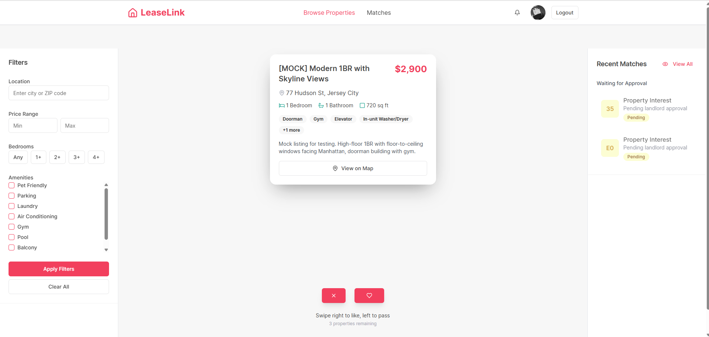
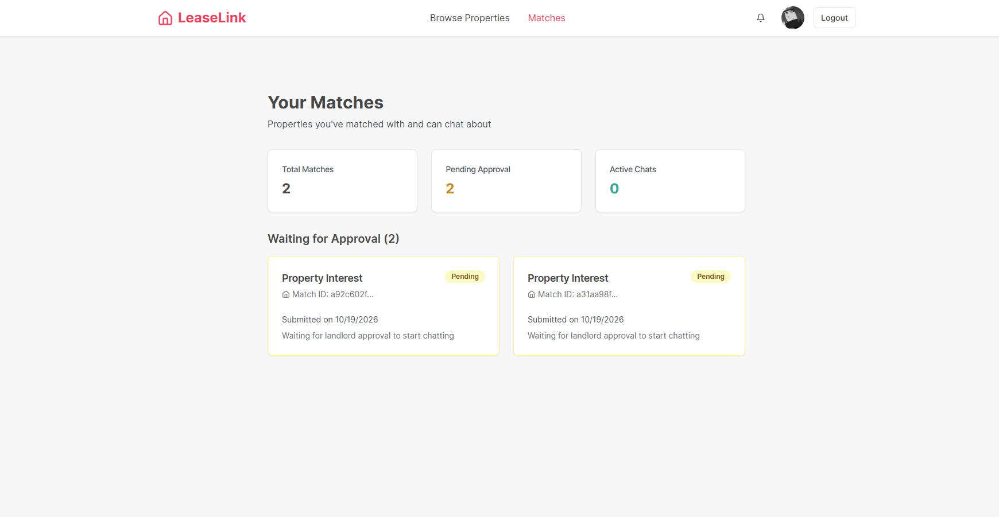
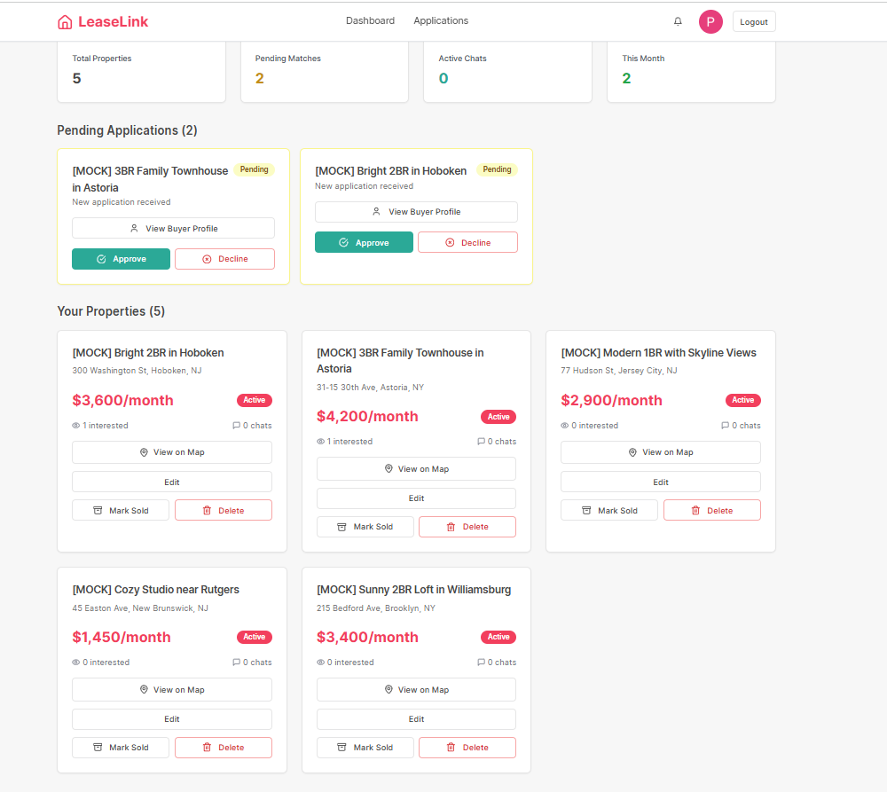
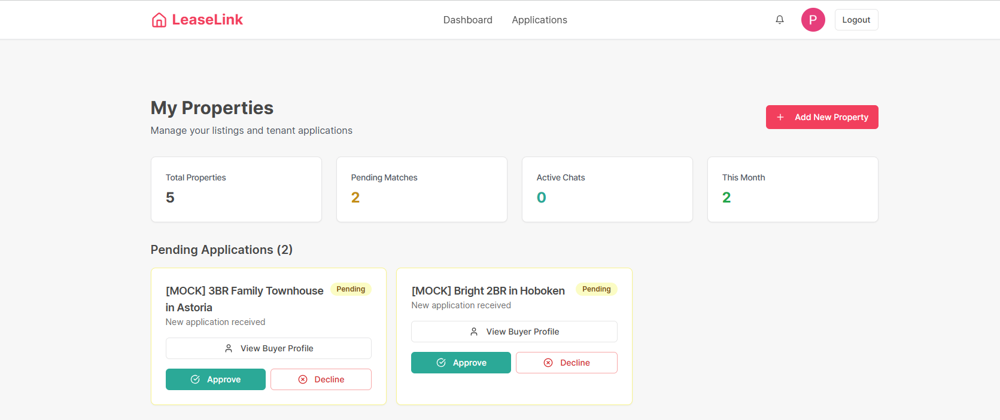
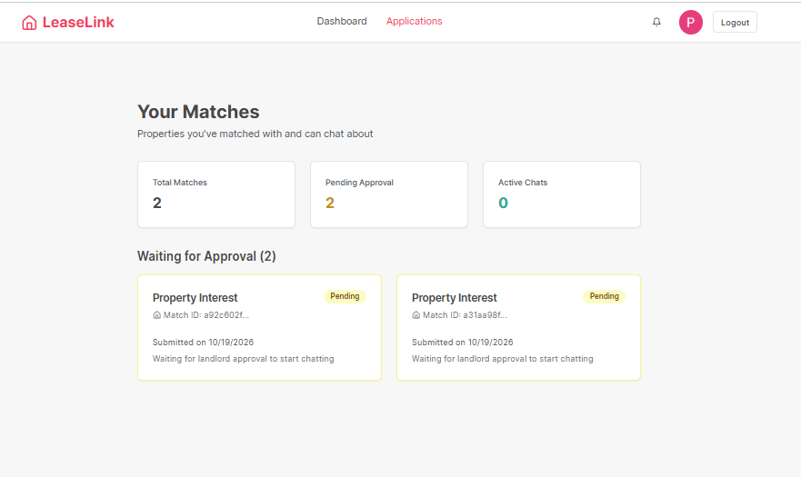

# LeaseLink

**1st place, MusaLabs Hackathon** (50+ teams). **Live:** https://lease-link-hazel.vercel.app

Swipe-to-match housing: renters swipe through listings, landlords swipe on renters, and a mutual match opens a real-time chat.

## What is LeaseLink?

LeaseLink lets you **swipe through property listings** that match your preferences. When both you and a landlord express interest, you get matched and can start chatting about your next home.

### For Renters/Buyers
- **Swipe Interface**: Browse properties with simple left/right swipes
- **Smart Matching**: Get matched when both parties show interest
- **Direct Chat**: Message landlords instantly after matching
- **Personalized Feed**: Properties tailored to your preferences/filters

### For Landlords
- **Property Management**: Add, edit, and manage all your listings
- **Tenant Applications**: Review interested renters and their information
- **Match Approval**: Accept or decline applications based on your criteria

## Screenshots

### Renter
| Browse & swipe | Matches |
|---|---|
|  |  |

### Landlord
| Dashboard | Pending applications |
|---|---|
|  |  |



## Quick Start

### Prerequisites
- Node.js 18+
- PostgreSQL database
- Google OAuth credentials

### 1. Clone & Install
```bash
git clone <repository-url>
cd leaselink
npm install
```

### 2. Environment Setup
Copy `.env.example` to `.env` and configure:

```env
# Database
DATABASE_URL=your_postgresql_connection_string

# Google OAuth (required)
GOOGLE_CLIENT_ID=your_google_client_id
GOOGLE_CLIENT_SECRET=your_google_client_secret

# Session Security
SESSION_SECRET=your_random_secret_key

# Optional: Google Maps
GOOGLE_MAPS_API_KEY=your_maps_api_key
VITE_GOOGLE_MAPS_API_KEY=your_maps_api_key
```

### 3. Database Setup
```bash
# Push schema to database
npm run db:push
```

### 4. Run Development Server
```bash
npm run dev
```

Visit `http://localhost:5000` and you should be good to go!

## How It Works

### The Matching Process
1. **Browse**: Swipe right on properties you like, left on ones you don't
2. **Interest**: When you swipe right, landlords see your application
3. **Match**: If landlords approve your application, you get matched
4. **Chat**: Start conversations about rent, move-in dates, and details

### User Types
- **Renters/Buyers**: Browse and swipe on properties
- **Landlords**: List properties and review applications

## Architecture

### Frontend (React + TypeScript)
- **Framework**: React with TypeScript 
- **UI**: Tailwind CSS
- 
### Backend (Node.js + Express)
- **Server**: Express.js with TypeScript
- **Database**: PostgreSQL
- **Auth**: Google OAuth 2.0

### Key Features
- **Cross-platform**: Works on desktop, tablet, and mobile
- **Real-time Chat**: Instant messaging between matches
- **Image Uploads**: Property photos and profile pictures
- **Responsive and Interactable Design**
- **Secure Authentication**: Google OAuth with session management

## Development

### Available Scripts
- `npm run dev` - Start development server
- `npm run build` - Build for production
- `npm run db:push` - Push database schema changes
- `npm run db:studio` - Open Drizzle Studio (database GUI)

### Project Structure
```
├── client/               # Frontend React app
│   ├── src/
│   │   ├── components/   # Reusable UI components
│   │   ├── pages/        # Route components
│   │   ├── hooks/        # Custom React hooks
│   │   └── lib/          # Utilities and configuration
├── server/               # Backend Express app
│   ├── routes.ts         # API route definitions
│   ├── storage.ts        # Database operations
│   └── googleAuth.ts     # Authentication setup
├── shared/               # Shared TypeScript types
│   └── schema.ts         # Database schema and types
└── public/               # Static assets
```


